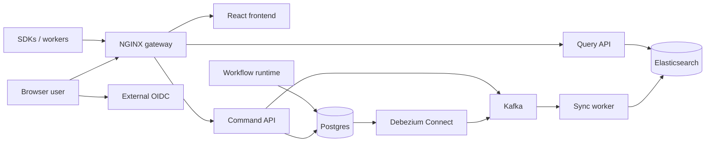

# ArtificialFlow

ArtificialFlow is an open-source BPMN workflow platform for modeling, running, and
observing business processes. It combines a Go workflow engine, a React modeler
and operations UI, a CQRS query projection, and OIDC-based identity. Client
libraries cover Node.js, .NET, and Java, plus worker clients for Python and Go.

Use Docker Compose to evaluate the platform on one machine. Use the Helm chart
for Kubernetes.

## What ArtificialFlow provides

- Browser BPMN modeler, process catalog, dashboards, and instance history
- Command API for workflow deployment, instance mutation, messages, and signals
- Runtime service for workflow execution, timers, jobs, and SLA processing
- External-worker API with locking, retries, idempotency, and capabilities
- User-task API (`GET /tasks`, claim, complete) for your own task applications
- Read-optimized query API backed by Elasticsearch
- Kafka event transport and Debezium CDC projection
- External OIDC for console login and API tokens, or no IAM for local evaluation

See the [BPMN support matrix](docs/BPMN_SUPPORT_MATRIX.md) for the current
engine contract.

## Architecture



Main components:

- **Gateway**: the single entry point. It routes `/` to the frontend, `/api/`
  to the command service, and `/api/query/` to the query service.
- **Frontend**: BPMN modeler, dashboards, process and instance views, human
  task views, and identity provider information.
- **Command service**: workflow writes, worker and user-task APIs, identity
  endpoints, idempotency, and the transactional outbox. It applies database
  migrations at startup.
- **Runtime**: advances workflow execution and handles timers and background
  work.
- **Sync worker**: consumes Kafka events and Debezium CDC records and writes
  search projections with bulk requests.
- **Query service**: serves read-optimized process and instance data from
  Elasticsearch.
- **IAM**: validates browser and machine identities through an external OIDC
  provider. Users, clients, and tokens are created in that provider.

Postgres is the source of truth. Query views are eventually consistent. Read
the [architecture guide](docs/architecture.md) and the
[CQRS runbook](docs/RUNBOOK_CQRS_SYNC.md).

## Quickstart

Requirements: Docker with Compose v2, Make, and `curl`. Free local ports
`5432`, `8080`, `8081`, `8083`, `8092`, `9092`, `9100`, and `9200`.

`docker-compose.yml` is self-contained. No `.env` is needed. It starts
Postgres, Elasticsearch, Kafka, Debezium Connect, and ArtificialFlow.

`IAM_DEPLOYMENT_MODE` is a boolean, `true` or `false`. Any other value fails
startup.

| `IAM_DEPLOYMENT_MODE` | Console login | API and SDKs |
| :--- | :--- | :--- |
| `false` (Compose default) | Local sign-in, `admin` / `admin` (`CONSOLE_ADMIN_USERNAME` / `CONSOLE_ADMIN_PASSWORD`) | No token needed. Every call runs as admin. |
| `true` (Helm default) | Your OIDC provider | Bearer token from your OIDC provider. Roles come from the token. |

`false` is for local evaluation only. The console login is a convenience gate
and does not protect the API. `AUTH_PRODUCTION=true` refuses to start in that
mode.

### Build from source

```bash
git clone https://github.com/artificialflow/artificialflow.git
cd artificialflow
make up            # no IAM: sign in at http://localhost:9100 with admin / admin
```

### Run published images

Clone the release tag you deploy, so the Compose file matches the images:

```bash
git clone --depth 1 --branch v1.2.0 https://github.com/artificialflow/artificialflow.git
cd artificialflow
make up-release    # pulls artificialflow/*:1.2.0 and starts without building
```

On a development branch, use `make up` instead. Published images may not match
the configuration in the branch. Set `ARTIFICIALFLOW_IMAGE_TAG` to pin another
published tag. See
[Docker images](docs/DOCKER_IMAGES.md) for tags and image verification.

### Use your OIDC provider

```bash
IAM_DEPLOYMENT_MODE=true \
AUTH_ISSUER_INTERNAL_URL=https://login.example.com \
AUTH_ISSUER_PUBLIC_URL=https://login.example.com \
make up            # or make up-release
```

Create the backend audience, the browser client, machine clients, and the four
roles in your provider first. See the [IAM guide](docs/iam.md) and the
recipes for [Keycloak](docs/iam/KEYCLOAK.md), [Entra ID](docs/iam/ENTRA.md),
and [Auth0](docs/iam/AUTH0.md).

### Verify

| Surface | URL |
| :--- | :--- |
| UI and gateway | <http://localhost:9100> |
| Command API | <http://localhost:9100/api/v1> |
| Query API | <http://localhost:9100/api/v1/query> |

```bash
curl -fsS http://localhost:9100/api/health
curl -fsS http://localhost:9100/api/query/health
curl -fsS http://localhost:8092/health
curl -fsS http://localhost:8083/connectors/artificialflow-postgres-connector/status
```

The command and query endpoints report `ok`, and the Debezium connector and
its tasks report `RUNNING`. Health checks are process-level only. For a full
check, deploy a workflow, start it, and see the instance in the query API. The
[getting started guide](docs/getting-started.md) walks through this with a
worker.

Useful commands: `make ps`, `make logs`, `make down`. `make clean` also
deletes the volumes.

## Production deployment

Docker Compose is not production hardened. It exposes infrastructure ports,
uses development credentials, and runs single-node dependencies.

For Kubernetes, use the [Helm chart](charts/artificialflow) and the
[deployment guide](docs/deployment.md#3-helm). The chart is
installed from a clone of the release tag. It covers:

- External OIDC (`iam.mode: true`, the default) or `iam.mode: false`
- Bundled Postgres, Elasticsearch, Kafka, and Debezium Connect, each
  replaceable with a managed service
- Migrations at startup, guarded by a startup probe and rolling updates with
  `maxUnavailable: 0`
- Secrets, TLS ingress, network policies, PDBs, autoscaling, and monitoring

Pin release images or digests and review their SBOM, provenance, scan, and
signature before rollout.

## IAM and authorization

ArtificialFlow recognizes four roles:

- `artificialflowadmin`: full access for platform administrators
- `artificialflowbusiness`: process designers. Deploy and view workflows and
  decisions. Instances, variables, deletes, and incidents are hidden.
- `artificialflowclient`: SDK, worker, API, and automation identities
- `artificialflowanalytics`: reserved for analytics (placeholder page only)

IAM signs in administrators and issues SDK and API tokens. End users of your
own applications are authenticated by your applications. Their backend fetches
tasks with `GET /tasks` and claims and completes them with an `assignee`.

Keep machine identities limited to `artificialflowclient`. See the
[IAM guide](docs/iam.md) for claim paths, JWT versus introspection, and
hardening.

## Clients

| Client | Scope | Install | Guide |
| :--- | :--- | :--- | :--- |
| Node.js / TypeScript | Full API, workers, user tasks | `npm install @artificialflow/nodejs-sdk` | [Node.js SDK](docs/sdk-nodejs.md) |
| .NET 8 | Full API, workers, user tasks | `dotnet add package ArtificialFlow.Sdk` | [.NET SDK](docs/sdk-dotnet.md) |
| Java 17 | Full API, workers, user tasks | Maven `io.artificialflow:artificialflow-sdk:1.2.0` | [Java SDK](docs/sdk-java.md) |
| Python 3.10+ | Workers only | `pip install -e clients/python-sdk` | [Python worker](docs/sdk-python.md) |
| Go | Workers only | `github.com/artificialflow/artificialflow/backend/libs/worker` | [Go worker](docs/sdk-go.md) |

With `IAM_DEPLOYMENT_MODE=true`, every client identity needs
`artificialflowclient`. Keep client secrets in a secret manager and never
expose them to browser code.

**Integrating without an SDK?** Use the [HTTP API guide](docs/API.md) and the
checked-in [OpenAPI contract](docs/openapi.yaml), also served at
`/api/openapi.yaml`.

## Documentation

Operators:

- [Getting started](docs/getting-started.md)
- [Deployment (Compose and Helm)](docs/deployment.md)
- [IAM](docs/iam.md)
- [Docker images](docs/DOCKER_IMAGES.md)
- [Compatibility matrix](docs/COMPATIBILITY_MATRIX.md)
- [Upgrade guide](docs/UPGRADE.md)
- [Operations](docs/operations.md)
- [Troubleshooting](docs/troubleshooting.md)

Integrators:

- [HTTP API](docs/API.md) and [OpenAPI contract](docs/openapi.yaml)
- [Worker API](docs/worker-api.md)
- SDKs: [Node.js](docs/sdk-nodejs.md), [.NET](docs/sdk-dotnet.md),
  [Java](docs/sdk-java.md), [Python worker](docs/sdk-python.md),
  [Go worker](docs/sdk-go.md)
- [BPMN support matrix](docs/BPMN_SUPPORT_MATRIX.md)

Project:

- [Architecture](docs/architecture.md)
- [Roadmap](ROADMAP.md)
- [Changelog](CHANGELOG.md)

## Develop from source

Requirements:

- Git and Make
- Go 1.26.10 or a compatible Go 1.26 toolchain
- Node.js 20+ and npm
- Docker with Compose v2
- Optional: .NET 8 SDK, Java 17 and Maven, Python 3.10+

```bash
git clone https://github.com/artificialflow/artificialflow.git
cd artificialflow

go mod download
npm --prefix frontend ci
npm --prefix clients/nodejs-sdk ci

make up                       # build and start the stack
make build-backend            # compile the Go services
npm --prefix frontend run dev # frontend dev server on port 5173
```

Migrations and Debezium connector registration run automatically when the
stack starts.

Fast checks:

```bash
go test ./backend/...
npm --prefix frontend test
npm --prefix clients/nodejs-sdk test
make sdk-dotnet               # .NET SDK build and tests
make sdk-java                 # Java SDK build and tests
make smoke                    # Compose config and Kafka wiring
make validate-helm
```

Deeper checks for the changed area:

```bash
make test-bpmn-matrix       # BPMN parser/runtime contract
make worker-conformance     # External worker HTTP contract; running stack required
make cqrs-e2e-smoke         # Write, project, and query path
make cqrs-parity-check      # Postgres/search projection parity
make test-integration       # Integration suite; running stack required
make test-e2e               # End-to-end suite
make test-security          # Security checks
make release-dry-run        # Release packaging and image validation
```

See [quality gates](docs/QUALITY_GATES.md) for required checks by change type.

## Contributing

Read [CONTRIBUTING.md](CONTRIBUTING.md), the
[Code of Conduct](CODE_OF_CONDUCT.md), and the
[dependency policy](docs/DEPENDENCY_POLICY.md). Keep pull requests small, add
tests and docs for behavior changes, and include the checks you ran.

Report security issues through [SECURITY.md](SECURITY.md), not a public issue.

## License

ArtificialFlow is licensed under the [MIT License](LICENSE).
